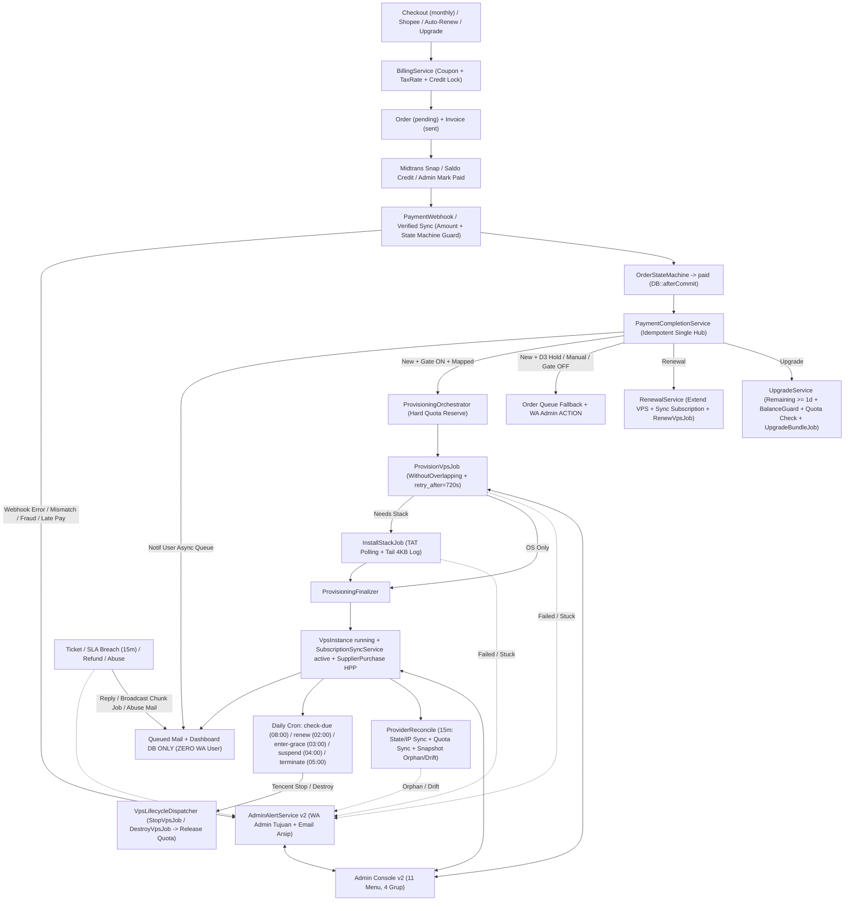

# MASTER PRD & ARCHITECTURAL BLUEPRINT: CravaCloud v2
## Admin Console Re-Architecture, Billing & Security Hardening, dan Notification/WhatsApp Overhaul

| Atribut | Detail |
| :--- | :--- |
| **Produk** | CravaCloud — PT Flustra Finances Artha |
| **Versi Dokumen** | `2.1 Final — Master Hardening, Automation & Notification Overhaul` |
| **Tanggal** | `2026-11-21` |
| **Mode** | Technical PRD & Implementation Blueprint (Siap Eksekusi Bertahap 5 Gelombang) |
| **Stack Wajib** | Laravel 12 (PHP 8.2+), MySQL 8, Blade + Tailwind + Alpine.js + Vite, Laravel Queue (Redis/Supervisor), Midtrans Snap/Core API, Tencent Cloud Lighthouse + TAT + Billing Native Client, CravaCloud WA Gateway (Admin-Only) |
| **Prinsip Eksekusi** | **Feedback Refinement** — menyempurnakan dan menyambungkan pondasi Phase 1–5F yang sudah ada, membuang dead-weight manual; **dilarang** remake dari awal atau migrasi stack (non-PostgreSQL/Next.js/Fastify) |
| **Dokumen Terkait** | [tencent-integration-blueprint.md](file:///D:/Project%20-%20Flustra.id/cravacloud/docs/tencent-integration-blueprint.md) · [katalog-stack-hostinger-parity.md](file:///D:/Project%20-%20Flustra.id/cravacloud/docs/katalog-stack-hostinger-parity.md) |

---

> ### Keputusan Final Terkunci (Locked Business Decisions — 2026-11-21)
> Seluruh desain di dokumen ini mengunci 4 keputusan bisnis berikut tanpa pengecualian:
> 1. **Password SSH Awal = Dashboard-Only (Zero Plaintext in Email):** `VpsProvisionedNotification` dan `resources/views/emails/vps-provisioned.blade.php` **TIDAK BOLEH** lagi mencetak `initial_root_password` secara plaintext di body email. Diseragamkan dengan `VpsPasswordResetNotification` & `completeReinstall`: pelanggan hanya diberi **Hostname, IP Publik, Port, `ssh_username` (`ubuntu` untuk Ubuntu / `root` untuk Debian/Rocky), `ssh_command`, dan tombol CTA menuju Dashboard → Detail VPS → tab Akses (ikon mata, terenkripsi at-rest, rate-limited 30/5m + tercatat log)**.
> 2. **Billing Cycle Dikunci `monthly` (1 Bulan) Saja:** Checkout (`OrderController::store`), Self-Service Renewal (`DashboardController::renewVps`), dan Auto-Renewal (`BillingService::renewSubscription`) **dikunci ke `billing_cycle = 'monthly'`** (1:1 dengan Tencent Lighthouse `Period = 1`). Request dengan nilai selain `monthly` (`quarterly`, `semi_annual`, `annual`) **ditolak (422)** untuk menutup total celah `GAP-01` dan risiko fluktuasi kurs/harga upstream.
> 3. **Pemisahan Tegas Kanal Notifikasi (Strict Channel Split):**
>    - **Pelanggan (User):** **100% Email + In-App Dashboard Database (`['mail', 'database']`) — ZERO WhatsApp** ke nomor pelanggan (termasuk reminder masa aktif, suspend, terminasi, faktur, lunas, VPS aktif, reset password, tiket, maintenance).
>    - **Admin Operasional:** **WhatsApp khusus Admin-to-Admin-Phone (`admin_notification_whatsapp`)** sebagai *Ops Pager* yang ringkas, terstruktur, anti-spam (cooldown/dedupe), dan dapat di-toggle per event dari Admin UI + Email arsip ke `MailIdentity::adminRecipients()`.
>    - **Komponen Tetap Dipertahankan:** Sinkronisasi SSO akun tertaut `LinkedAccount*` (`KirimAkunTertautCommand`, `LinkedAccountObserver`, `LinkedAccountController`, `LinkedAccountLookupController`) dan link klik CS publik `support_whatsapp` (`App\Support\NomorWhatsApp`) **tetap utuh** dan tidak diputus.
> 4. **Skema Non-Destruktif di Rilis v2.1:** Tidak ada `DROP TABLE` / `DROP COLUMN` pada rilis ini agar data historis produksi 100% aman. Kolom/tabel manual di-deprecate dari jalur penulisan baru terlebih dahulu.

---

## 1. Executive Summary & Success Metrics (KPI)

Backend otomasi CravaCloud (**Midtrans + Tencent Cloud Lighthouse + TAT 177 Stack + Day-2 Self-Service**) sudah terbangun ~90% hingga Phase 5F (`ProvisioningOrchestrator`, `ProvisioningFinalizer`, `TencentLighthouseProvider`, `VpsDay2Service`, `VpsLifecycleDispatcher`, `ProviderReconcileCommand`, `RenewVpsJob`, `DestroyVpsJob`, `ReinstallVpsJob`, `UpgradeBundleJob`).

Namun audit menyeluruh terhadap seluruh controller, service, cron scheduler, template Blade, dan mekanisme notifikasi membuktikan bahwa **4 lapisan krusial masih tertinggal di era reseller manual atau menyimpan celah produksi serius**:

1. **Celah Finansial, Keamanan, & Queue Concurrency (P0):** Exploit `billing_cycle` pada perpanjangan mandiri, race condition double-spend saldo credit, 2FA bypass saat guest checkout, konfigurasi queue `retry_after` (90 dtk) lebih pendek daripada timeout job (600 dtk), dan fallback email admin hardcode ke `admin@gmail.com`.
2. **Siklus Billing Terputus ("Phantom Subscription"):** Belum ada kode yang pernah membuat baris pada tabel `subscriptions`, sehingga 5 cron SaaS (`billing:*`) tidak memproses layanan nyata; sebaliknya cron lama `renewal:remind` masih memindahkan status DB ke `suspended`/`terminated` secara langsung tanpa memanggil `StopVpsJob`/`DestroyVpsJob` ke Tencent Cloud.
3. **Admin Panel Manual-First & Blind Spot Upstream:** Sidebar memiliki **20 menu datar tanpa pengelompokan**, `AdminController.php` membengkak menjadi **1.984 baris**, tidak ada tombol Suspend/Unsuspend/Terminate/Sync Tencent di UI `instances`, tidak ada layar console untuk `ProvisioningTask` maupun `failed_jobs`, dan 4 setting utama Tencent tidak memiliki UI.
4. **Arsitektur Notifikasi & WhatsApp Tidak Selaras Operasional:** 14 class notifikasi pelanggan masih mengirim WhatsApp ke nomor pelanggan, 481 baris dead-code tertinggal di `WhatsAppNotifier`, seluruh 27 class notifikasi berjalan sinkron tanpa queue, sementara insiden kritis bagi admin (webhook gagal, nominal mismatch, provisioning gagal, order Shopee, SLA tiket terlewat) belum terhubung ke WA Admin Router yang terstruktur.

### Success Metrics (KPI Rilis v2.1)

| Metrik | Kondisi Saat Ini | Target Rilis v2.1 |
| :--- | :--- | :--- |
| Celah P0 Keamanan/Finansial | 7 celah aktif (`GAP-01..06, 21`) | **0 celah** (terverifikasi PHPUnit feature test) |
| Kebocoran WA ke Nomor Pelanggan | 14 class kirim WA ke `$user->phone` | **0 pengiriman WA ke user non-admin** |
| Password SSH Plaintext di Email | Tercetak jelas di `vps-provisioned.blade.php` | **0 password plaintext di body email** |
| Sinkronisasi Lifecycle DB ↔ Tencent | `renewal:remind` & `instances` dropdown bypass API | **100% lewat `VpsLifecycleDispatcher` & `SubscriptionSyncService`** |
| Observabilitas Provisioning & Upstream | 0 layar `ProvisioningTask`/TAT/Setting Tencent di UI | **100% kontrol dari Admin Web UI** (tanpa SSH/Tinker) |
| Pengiriman Email & Broadcast | 0/27 queued, broadcast sinkron (risiko 504) | **Queue `notifications` async** + chunked broadcast job |
| Struktur Navigasi Admin | 20 menu datar + orphan `/admin/payments` | **11 menu dalam 4 grup** + `AdminController` terpecah |
| Stabilitas Test Suite | 592 test eksisting | **Seluruh test eksisting + suite test baru 100% PASS** |

---

## 2. Full Audit Matrix — Seluruh 26 Celah & Bug Terverifikasi

### 2.1 Prioritas P0 — Kritis (Finansial, Keamanan, Queue Concurrency, Kebocoran Biaya)

| ID | Celah / Bug | Bukti File & Baris | Akar Masalah & Dampak Nyata |
| :--- | :--- | :--- | :--- |
| **GAP-01** | **Exploit `billing_cycle` di Self-Service Renewal (Bayar 1 Bln → Dapat 12 Bln)** | `app/Http/Controllers/DashboardController.php:642-767`<br>`app/Models/VpsInstance.php:515-526`<br>`app/Services/RenewalService.php:196-255` | `$instance->renewal_price` adalah tarif **1 bulan**, tetapi `$request->input('billing_cycle')` diambil mentah tanpa validasi dan tanpa mengalikan harga dengan jumlah bulan. Pelanggan yang mengirim `billing_cycle=annual` hanya membayar tarif 1 bulan tetapi `RenewalService` menambah masa aktif **12 bulan** sekaligus memanggil `RenewVpsJob` (`RenewInstances(Period=12)`). |
| **GAP-02** | **Phantom Subscription & Cron `renewal:remind` Bypass Tencent API** | 0 call site `Subscription::create` di `app/`<br>`app/Console/Commands/SendRenewalRemindersCommand.php:118-148`<br>`routes/console.php:17-77` | Tabel `subscriptions` tidak pernah diisi saat VPS aktif sehingga 5 cron SaaS (`billing:renew`, `billing:enter-grace`, `billing:suspend-overdue`, `billing:terminate-expired`, `billing:check-due`) tidak pernah bekerja pada order nyata. Hanya `renewal:remind` (09:00) yang berjalan dan langsung mengeksekusi `$instance->update(['status' => 'suspended'])` serta `['status' => 'terminated']` **tanpa memanggil `VpsLifecycleDispatcher`**. Akibatnya DB berstatus terminated, **VM Tencent tetap hidup & slot kuota tidak pernah dilepas**. |
| **GAP-03** | **`BillingService::renewSubscription()` Salah Tipe Order + Spam Invoice Harian** | `app/Services/BillingService.php:387-423`<br>`app/Models/Order.php:332-340`<br>`app/Console/Commands/BillingRenewCommand.php:35-55` | Saat membuat order renewal otomatis, field `'order_type' => 'renewal'`, `'vps_instance_id'`, dan `'organization_id'` tidak diisi. Akibatnya `Order::isNew()` bernilai `true` — saat dibayar oleh pelanggan, `ProvisioningOrchestrator` akan mengiranya order baru dan **membeli VM Tencent kedua**! Selain itu `billing:renew` tidak mengecek invoice pending yang sudah terbit sehingga menagih & mengirim email berulang setiap hari, serta `RenewalService` belum menyinkronkan tanggal/status kembali ke `Subscription`. |
| **GAP-04** | **Queue `retry_after` (90 dtk) < Job `$timeout` (600 dtk)** | `config/queue.php:43,71`<br>`app/Jobs/Provisioning/AbstractProvisioningJob.php:32` | `AbstractProvisioningJob` menetapkan `$timeout = 600` detik, sedangkan koneksi `database` & `redis` memakai default `retry_after = 90` detik. Provisioning Tencent/TAT normalnya butuh 2–5 menit; pada detik ke-91 worker kedua mengambil job yang sama secara paralel → **tabrakan `ResetInstancesPassword`, TAT script berjalan ganda, atau double-charge `RenewInstances`**. |
| **GAP-05** | **2FA Bypass lewat Guest Checkout** | `app/Http/Controllers/OrderController.php:256-295` | Pada jalur guest checkout, bila email & password cocok dengan akun eksisting, sistem melakukan `Auth::login($user)` dan di baris 295 langsung menulis `$request->session()->put('2fa.passed', true)` **tanpa mengecek `$existingUser->hasTwoFactorEnabled()`**, berbeda dengan `quickLogin()` (baris 86–95). |
| **GAP-06** | **Race Condition Double-Spend Saldo Credit** | `app/Services/BillingService.php:312-330`<br>`app/Http/Controllers/DashboardController.php:652-699` | Berbeda dengan `adjustCredit()` yang sudah mengunci baris `User::whereKey($customer->id)->lockForUpdate()`, method `deductCredit()` membaca saldo tanpa row lock dan juga bisa dipanggil berulang lewat request paralel pada `renewVps`. Dua request paralel dapat membelanjakan saldo yang sama dua kali. |
| **GAP-21** | **Fallback Hardcode Berbahaya ke `admin@gmail.com`** | `app/Support/MailIdentity.php:233` | Apabila setting DB `mail_admin_addresses` dan env `mail.admin_addresses` kosong, daftar penerima email admin jatuh ke hardcode `['support@cravacloud.id', 'admin@gmail.com']` — membuka risiko kebocoran detail order, error teknis, dan laporan SLA ke alamat pihak ketiga. |

### 2.2 Prioritas P1 — Tinggi (Billing Integrity, State Drift, Control Plane Admin, Notifikasi)

| ID | Celah / Bug | Bukti File & Baris | Akar Masalah & Dampak Nyata |
| :--- | :--- | :--- | :--- |
| **GAP-07** | **Midtrans Sync Tanpa Cek Nominal & Bypass `OrderStateMachine`** | `app/Services/Payments/MidtransService.php:326-435`<br>`app/Http/Controllers/Api/PaymentWebhookController.php:489-494` | `checkAndSyncStatus()` & `settleOrderFromMidtrans()` tidak memvalidasi kesesuaian `gross_amount` vs `order.amount`, dan blok `catch` di `MidtransService.php:423-427` melakukan `$order->update(['status' => 'paid'])` secara paksa walaupun `OrderStateMachine` menolak (mis. order sudah `cancelled` atau `expired`). Di sisi webhook, fallback `preg_replace('/[^0-9]/', '')` berisiko memetakan test ping / order ID eksternal ke order angka yang salah. |
| **GAP-08** | **Reuse Pending Renewal Merusak Snap Token & Kolom Non-Eksis** | `app/Http/Controllers/DashboardController.php:717-732`<br>`app/Services/Payments/MidtransService.php:116-130` | Mengubah `amount` langsung pada order renewal `pending` membuat token Snap lama (yang di-cache 12 jam) memiliki nominal berbeda dari DB, memicu penolakan webhook `Amount mismatch (422)`. Selain itu L727–728 menulis kolom `total` yang tidak ada di skema tabel `invoices`. |
| **GAP-09** | **Upgrade Lintas Pool Tanpa Cek Saldo/Kuota & Celah Invoice Rp0** | `app/Services/UpgradeService.php:120-219`<br>`app/Services/Provisioning/Providers/TencentLighthouseProvider.php:434-477`<br>`app/Jobs/Provisioning/UpgradeBundleJob.php:60-118` | 1) `upgradeBundle()` tidak memanggil `BalanceGuard::assertSufficient()`; 2) Upgrade lintas `upstream_bundle_type` (`STARTER_BUNDLE` → `GENERAL_BUNDLE`) tidak mengecek ketersediaan kuota pool tujuan maupun memindahkan slot `used` saat sukses; 3) Saat `remaining_days == 0`, prorata bernilai Rp0 (invoice berstatus `paid`, tapi order tetap `pending` dan job tidak ter-dispatch); 4) Tidak ada guard mencegah spam order upgrade `pending` ganda; 5) `Subscription` tidak diperbarui ke `targetSpec`. |
| **GAP-10** | **Checkout Abaikan `BillingService` (Kupon, Pajak, & Saldo Credit Mati)** | `app/Http/Controllers/OrderController.php:338-424` | Checkout order baru menghitung harga mentah langsung dari `$spec->sell_price` dan mem-bypass `BillingService::calculatePrice()`, sehingga fitur `Coupon`, `TaxRate` (PPN), dan `CreditTransaction` (saldo hasil refund) tidak pernah bisa dipakai pelanggan saat checkout baru. |
| **GAP-11** | **`orders:expire-pending` Tidak Membatalkan Invoice `sent`** | `app/Console/Commands/ExpirePendingOrdersCommand.php:56` | Hanya memeriksa `in_array($order->invoice->status, ['draft', 'unpaid', 'pending'])`, padahal semua invoice yang diterbitkan `OrderController::store` dan `BillingService::generateInvoice` berstatus **`'sent'`** → invoice dari order kadaluarsa tetap dianggap tagihan terbuka. |
| **GAP-12** | **Admin Panel Manual-First & Terputus dari Engine Tencent** | `resources/views/admin/instances.blade.php:252-267`<br>`app/Http/Controllers/AdminController.php:617-641,889-925,1078,1221`<br>`resources/views/admin/orders.blade.php:202-212`<br>`resources/views/admin/monitoring.blade.php:72-88`<br>`resources/views/admin/packages.blade.php`<br>`resources/views/dashboard/partials/day2-panel.blade.php:236` | 1) Kolom aksi `instances` hanya dropdown status DB-only (route `suspend/unsuspend/terminate` Tencent tidak punya tombol di UI); 2) `retryProvision` malah menyuruh admin isi form IP manual; 3) `Proses Shopee` mengalami race condition `DB::afterCommit` vs blok manual + fallback `'root'` di L1078; 4) Widget saldo di `Monitoring` baca key `tencent:balance` (TTL 60s) padahal `tencent:check-balance` mengisi `tencent:balance:last` (TTL 7 hari) → saldo hampir selalu tampil `—`; 5) Nol UI untuk 4 setting Tencent (`provisioning_auto_enabled`, `whitelist`, `quota_guard_mode`, `tencent_usd_idr`), kapasitas `UpstreamQuotaPool`, `vps_specs.upstream_bundle_id/type`, tabel `provisioning_tasks`, & `failed_jobs`; 6) Admin tidak dapat memicu Reinstall Otomatis pada panel Day-2 (`!$isAdminCtx`). |
| **GAP-17** | **14 Notifikasi Pelanggan Masih Mengirim WhatsApp + Dead-Code `WhatsAppNotifier`** | `app/Notifications/{BillingReminder,InstanceRenewalReminder,InvoiceCreated,MaintenanceScheduled,PaymentReceived,PaymentRejected,ServiceSuspended,ServiceTerminated,TicketReplied,VpsPasswordReset,VpsProvisioned,VpsSshUsernameChanged,VpsUpgraded,WelcomeCredentials}Notification.php`<br>`app/Channels/WhatsAppChannel.php`<br>`app/Services/WhatsAppNotifier.php` (481 baris)<br>`app/Services/WhatsAppMessage.php`<br>`app/Models/User.php:226-229`<br>`resources/views/order/success.blade.php:177`<br>`resources/views/order/partials/slide-account.blade.php:37,136` | Bertentangan dengan kebijakan final (pelanggan hanya email). Membuka risiko nomor WA Gateway terkena suspend akibat spam notifikasi otomatis ke ratusan user, serta menimbulkan beban latency ekstra saat webhook/checkout. |
| **GAP-18** | **0 dari 27 Notifikasi Menggunakan `ShouldQueue` (100% Sinkron)** | Seluruh file di `app/Notifications/*.php`<br>`app/Http/Controllers/Admin/BroadcastController.php:77-96` | Tidak satu pun class notifikasi mengimplementasikan `ShouldQueue`. Render DomPDF invoice dan panggilan SMTP dilakukan sinkron di dalam HTTP request / webhook. Fitur `BroadcastController::send()` melakukan loop kirim email sinkron untuk seluruh user → risiko tinggi **HTTP 504 Gateway Timeout**. |
| **GAP-19** | **Crash `Undefined variable $adminEmail` di `tickets:check-sla` + Tidak Dijadwalkan** | `app/Console/Commands/CheckTicketSlaBreachCommand.php:43`<br>`routes/console.php` | Command melempar `ErrorException: Undefined variable $adminEmail` begitu ada tiket pertama yang melewati SLA, tidak mengirim ke semua recipient `MailIdentity::adminRecipients()`, tidak terdaftar di `routes/console.php`, tidak punya deduplikasi (akan spam per run), dan tidak mengirim alert WA Admin. |
| **GAP-20** | **Blind Spot Alert WA Admin untuk Insiden Kritis + Teks Era Manual** | `app/Services/AdminAlertService.php:59-245`<br>`app/Http/Controllers/Api/PaymentWebhookController.php:228-445`<br>`app/Services/Provisioning/ProvisioningFinalizer.php:170-180` | Event fatal seperti **pembayaran/webhook gagal, `Amount mismatch`, `fraud challenge`, late payment, provisioning/reinstall/upgrade gagal, order Shopee masuk, pengajuan refund, kasus abuse kritis, & ticket SLA breach** tidak mengirim alert WA ke nomor tujuan Admin. Sebaliknya `orderPaid()` masih menyuruh admin membuka `/admin/fulfillment` dan memperpanjang manual di `/admin/supplier-purchases` meski order sudah otomatis Tencent. Tidak ada granular toggle event di UI. |

### 2.3 Prioritas P2 — Menengah (Observabilitas, Bug Template, Audit, & Tech Debt)

| ID | Celah / Bug | Bukti File & Baris | Akar Masalah & Dampak Nyata |
| :--- | :--- | :--- | :--- |
| **GAP-13** | **Output Log TAT Terpotong di Awal, Bukan Tail Error** | `app/Services/Provisioning/StackInstallerService.php:91` | `mb_substr($decoded, 0, 2000)` memotong output dari karakter pertama (umumnya log `apt-get update` awal), sehingga pesan kegagalan sebenarnya di baris akhir log shell terbuang. |
| **GAP-14** | **Abuse Controller Terputus dari Tencent & Typo `$user->name`** | `app/Http/Controllers/Admin/AbuseController.php:106,144-167`<br>`app/Models/User.php:20` | Kolom nama user adalah `full_name`, bukan `name` → email peringatan abuse selalu menyapa `"Pelanggan"`. Menutup kasus dengan status `terminated` tidak memicu suspensi/terminasi nyata via `VpsLifecycleDispatcher`. |
| **GAP-15** | **Admin API Tanpa Rate Limiter, Audit Log, & Mapping Legacy** | `routes/api.php:14-18`<br>`app/Http/Controllers/Api/AdminApiController.php:273-331` | Endpoint `/api/admin/*` tidak memakai `throttle`, mutasi via API tidak menulis `AdminAuditLog`, dan `processShopeeOrder` masih membawa 60 baris hardcode mapping nama paket pensiunan. |
| **GAP-16** | **Dead Code, Orphan Routes, God Controller, & Hardcode Legacy** | `routes/web.php:299-302`<br>`app/Http/Controllers/AdminController.php` (1.984 baris, L105-303, L1115-1187)<br>`app/Http/Controllers/Admin/FulfillmentController.php`<br>`resources/views/layouts/admin.blade.php:42-210`<br>`app/Models/VpsInstance.php:194-199,419`<br>`app/Models/VpsSpec.php:86-102` | Orphan `/admin/payments` & `payments.blade.php` masih hidup di route meski dibuang dari sidebar; Papan Fulfillment kanban manual; 20 menu sidebar datar; `AdminController` terlalu gemuk; copywriting *"Sedang Diproses Tim"* untuk auto-reinstall Tencent; hardcode spec ID `[7..13]`; accessor `VpsInstance::getAppUrlAttribute()` lama bentrok dengan port terbaru di `StackRegistry`. |
| **GAP-22** | **Bug `$user->name` Kosong di `BroadcastController`** | `app/Http/Controllers/Admin/BroadcastController.php:79,136` | Sama seperti `AbuseController`, `BroadcastController` membaca `$user->name` → placeholder `{{nama}}` jatuh ke `"Pelanggan"` dan kolom `Nama` pada file CSV ekspor kontak kosong. |
| **GAP-23** | **Bug Template Email Pelanggan + Kebijakan Password** | `resources/views/emails/vps-provisioned.blade.php:28-67`<br>`resources/views/emails/payment-received.blade.php:56-58` | 1) `$instance->vpsSpec` tidak ada relasinya (`Order` yang punya `vpsSpec`) → nama paket selalu tercetak `"VPS Instance"`; 2) OS tampil mentah (`UBUNTU2404`), control panel tampil `ucfirst()` mentah, & `app_url` belum ditampilkan; 3) `payment-received` untuk order Renewal/Upgrade masih menulis *"Sistem sedang mempersiapkan server VPS Anda"*; 4) `vps-provisioned` masih mengirim password plaintext di email. |
| **GAP-24** | **`WhatsAppController` Tidak Mencatat `AdminAuditLog` + Tanpa Riwayat Alert** | `app/Http/Controllers/Admin/WhatsAppController.php:23-170` | Memasang trait `LogsAdminAudit` tetapi tidak memanggil `$this->audit(...)` saat API key/URL/enable diubah atau tes kirim dijalankan; admin juga tidak bisa melihat log alert internal yang dikirim/gagal. |
| **GAP-25** | **`AdminAlertService::digest()` Memakai `Mail::raw` & Tanpa Cooldown Global** | `app/Services/AdminAlertService.php:127-143` | Email digest memakai `Mail::raw` polos tanpa desain brand `emails.layouts.master` dan tanpa global cooldown per event sehingga error berulang bisa membanjiri WA admin. |
| **GAP-26** | **Isolasi Wajib SSO `LinkedAccount*` & Tombol Publik `support_whatsapp`** | `app/Console/Commands/KirimAkunTertautCommand.php`<br>`app/Observers/LinkedAccountObserver.php`<br>`app/Support/NomorWhatsApp.php` | Penonaktifan WA untuk user **wajib terisolasi** agar tidak merusak sinkronisasi akun SSO dengan `wa.cravacloud.id` (`LinkedAccounts`) dan tombol WhatsApp Support manual untuk calon pembeli. |

---

## 3. Arsitektur Target End-to-End



### Peta Kepemilikan Data (Single Source of Truth)

| Entitas / Tabel | Pemilik Tunggal Mutasi Status / Nilai | Catatan v2.1 |
| :--- | :--- | :--- |
| `orders` | `OrderStateMachine` | Tidak boleh ada bypass update `status` langsung di webhook/sync. |
| `invoices` & `invoice_items` | `BillingService` + `OrderStateMachine` (`paid`/`cancelled`) | Line items immutable; `orders:expire-pending` wajib ikut batalkan `sent`. |
| `subscriptions` | `SubscriptionSyncService` + `RenewalService` + `Billing*Command` + `DestroyVpsJob` | Dibuat 1:1 otomatis untuk setiap `VpsInstance` aktif. |
| `vps_instances` | `VpsStateMachine` (dipicu `ProvisioningFinalizer`, `VpsLifecycleDispatcher`, `ProviderReconcileCommand`, & tombol admin) | Status untuk `provider='tencent'` tidak boleh diubah manual secara DB-only (wajib lewat `VpsLifecycleDispatcher`). |
| `provisioning_tasks` | `ProvisioningOrchestrator`, `VpsDay2Service`, `VpsLifecycleDispatcher`, `UpgradeService`, `AbstractProvisioningJob`, Admin Task Retry/Cancel | Sumber kebenaran progress & error TAT untuk UI Monitoring Admin maupun Dashboard User. |
| `supplier_purchases` | `ProvisioningFinalizer`, `RenewVpsJob`, `UpgradeBundleJob` (otomatis USD × `tencent_usd_idr`); `SupplierPurchaseController` hanya fallback legacy manual | Tetap dipertahankan untuk akuntansi HPP riil (`MarginService`) dan deadline safety terminate. |
| `upstream_quota_pools` | `UpstreamQuotaService` + `ProviderReconcileCommand` (`syncFromProvider`) + Admin Edit Capacity | Kapasitas dapat diubah dari UI Pengaturan → Provisioning & Tencent. |
| `admin_alert_wa_events` (`settings`) | `SettingsController` | Mengatur toggle event apa saja yang dikirim ke WA tujuan Admin. |

---

## 4. Desain Teknis Detail — Modul 1: Security, Financial & Queue Hardening (`FR-01`)

### 4.1 Hardening Self-Service Renewal (`DashboardController::renewVps`)
- **Lokasi:** [DashboardController.php](file:///D:/Project%20-%20Flustra.id/cravacloud/app/Http/Controllers/DashboardController.php#L624-L770)
- **Aturan Baru:**
  1. Validasi request:
     ```php
     $validated = $request->validate([
         'billing_cycle' => ['nullable', 'string', Rule::in(['monthly'])],
         'payment_method' => ['nullable', 'string', 'max:50'],
     ]);
     $billingCycle = 'monthly';
     ```
     Selain `'monthly'`, request otomatis ditolak `422 ValidationException`.
  2. Hitung nominal selalu lewat `BillingService::calculatePrice()` dengan `baseMonthly` = `$instance->renewal_price` dan `$months = 1` (+ `TaxRate` bila aktif agar selaras antara auto-renew & manual renew).
  3. **Penanganan Pending Renewal Order Sebelumnya (GAP-08):**
     - Cek pending renewal order `< 24 jam`:
       - Jika masih ada dan **`(float) $existingOrder->amount === (float) $breakdown['total']`** serta metode pembayaran sama → langsung redirect ke `route('order.payment', $existingOrder->id)` tanpa memodifikasi `amount` maupun `invoices` (token Snap tetap valid 100%).
       - Jika nominal atau harga paket berubah → dalam `DB::transaction`, batalkan order lama via `OrderStateMachine::transition($existingOrder, 'cancelled', ['reason' => 'Digantikan tagihan perpanjangan baru.', 'actor_type' => 'system'])`, ubah `invoice->status = 'cancelled'`, tandai `PaymentTransaction` pending terkait menjadi `'expired'`, lalu buat order renewal + invoice baru yang bersih.
     - Hapus seluruh penulisan ke kolom `'total'` pada tabel `invoices` (karena kolom di `invoices` adalah `'amount'`, `'subtotal'`, `'discount_total'`, `'tax_total'`, `'credit_applied'`).

### 4.2 Locking Saldo Credit (`BillingService::deductCredit`)
- **Lokasi:** [BillingService.php](file:///D:/Project%20-%20Flustra.id/cravacloud/app/Services/BillingService.php#L312-L330)
- **Aturan Baru:**
  - Bungkus seluruh `deductCredit()` dalam `DB::transaction(...)` dengan row lock `User::whereKey($customer->id)->lockForUpdate()->first()` (menyamai pola `adjustCredit()`), baca ulang `CreditTransaction::balanceFor($customer->id)` di dalam lock sebelum menulis mutasi negatif, dan pada `DashboardController::renewVps()` jalur saldo credit bungkus pengecekan saldo + `deductCredit` di transaksi yang sama sehingga double-click/race paralel selalu gagal aman di request kedua.

### 4.3 Menutup Celah 2FA Guest Checkout (`OrderController::store`)
- **Lokasi:** [OrderController.php](file:///D:/Project%20-%20Flustra.id/cravacloud/app/Http/Controllers/OrderController.php#L256-L296)
- **Aturan Baru:**
  - Setelah `$existingUser` lulus `Hash::check`:
    - Jika `$existingUser->hasTwoFactorEnabled()`: **JANGAN panggil `Auth::login($user)` dan JANGAN set `session('2fa.passed', true)`**. Simpan `2fa.pending_user_id` di session dan kembalikan respon JSON `{ success: false, requires_2fa: true, redirect: route('two-factor.challenge') }` atau redirect ke `route('two-factor.challenge')` (identik dengan `quickLogin()`).
    - Hanya jika `! $existingUser->hasTwoFactorEnabled()` barulah `Auth::login()` + `session(['2fa.passed' => true])` diizinkan.

### 4.4 Hardening Midtrans Sync & Webhook (`MidtransService` & `PaymentWebhookController`)
- **Lokasi:** [MidtransService.php](file:///D:/Project%20-%20Flustra.id/cravacloud/app/Services/Payments/MidtransService.php#L326-L435), [PaymentWebhookController.php](file:///D:/Project%20-%20Flustra.id/cravacloud/app/Http/Controllers/Api/PaymentWebhookController.php#L471-L497)
- **Aturan Baru:**
  1. Pada `MidtransService::checkAndSyncStatus()` & `settleOrderFromMidtrans()`: wajib validasi `abs((float) $grossAmount - (float) $order->amount) <= 0.01`. Bila tidak cocok → `Log::critical('midtrans.sync_amount_mismatch', ...)` + trigger `AdminAlertService::alert('payment.failed', ...)` + **return null / abort settlement**.
  2. Hapus blok `catch` di `MidtransService.php:420-435` yang menimpa `$order->update(['status' => 'paid'])` secara paksa. Jika `OrderStateMachine` menolak (karena order sudah `cancelled` atau `expired` akibat timeout 24 jam):
     - Catat `PaymentTransaction` dengan `status = 'settled'` agar uang tercatat,
     - Jangan aktifkan order secara diam-diam, tetapi kirim alert kritis **`payment.late_settled`** ke WA + Email Admin agar admin memutuskan refund/reaktivasi.
  3. Di `PaymentWebhookController::resolveOrder()`: hapus blok regex brutal `preg_replace('/[^0-9]/', '', $rawOrderId)` ([baris 489-494](file:///D:/Project%20-%20Flustra.id/cravacloud/app/Http/Controllers/Api/PaymentWebhookController.php#L489-L494)). Pencocokan order hanya boleh lewat ID numerik persis, prefix resmi `CRV-|ORDER-|VX-`, `invoice_number`, atau `payment_transactions.provider_order_ref`.

### 4.5 Hardening Queue Concurrency (`config/queue.php` & `AbstractProvisioningJob`)
- **Lokasi:** [config/queue.php](file:///D:/Project%20-%20Flustra.id/cravacloud/config/queue.php#L43-L71), [AbstractProvisioningJob.php](file:///D:/Project%20-%20Flustra.id/cravacloud/app/Jobs/Provisioning/AbstractProvisioningJob.php#L27-L66)
- **Aturan Baru:**
  1. Naikkan fallback default `'retry_after'` pada koneksi `database` dan `redis` di `config/queue.php` dari `90` menjadi **`720`** (wajib lebih besar dari `$timeout = 600` detik pada `AbstractProvisioningJob` — plus perbarui `.env.example` `DB_QUEUE_RETRY_AFTER=720` dan `REDIS_QUEUE_RETRY_AFTER=720`).
  2. Implementasikan method `middleware(): array` di `AbstractProvisioningJob`:
     ```php
     public function middleware(): array
     {
         return [
             (new \Illuminate\Queue\Middleware\WithoutOverlapping('prov-task-' . $this->taskId))
                 ->expireAfter(660)
                 ->releaseAfter(30),
         ];
     }
     ```
     Ini menjamin satu `ProvisioningTask` tidak akan pernah dieksekusi oleh 2 worker secara bersamaan pada kondisi retry/stall apa pun.

---

## 5. Desain Teknis Detail — Modul 2: Billing & Subscription Unification (`FR-02`)

### 5.1 Service Baru: `App\Services\SubscriptionSyncService`
Menghilangkan kondisi *"Phantom Subscription"* dan menjadikan tabel `subscriptions` sinkron 1:1 dengan `VpsInstance`:
- `ensureForInstance(VpsInstance $instance): Subscription` (idempoten by `vps_instance_id`):
  - Ambil `Order` awal + `VpsSpec` + `grace_period_ends_at`.
  - Buat atau update baris `subscriptions` dengan:
    - `customer_id`, `organization_id`, `vps_spec_id`, `vps_instance_id`, `order_id`
    - `status`: dipetakan dari `$instance->status` (`running`/`stopped`/`rebooting`/`reinstalling` → `'active'`, `suspended` → `'suspended'`, `terminated` → `'terminated'`)
    - `billing_cycle`: `'monthly'`
    - `unit_amount`: `$instance->renewal_price`
    - `auto_renew`: `(bool) ($instance->auto_renew ?? true)`
    - `current_period_start`: `$instance->starts_at ?? now()`
    - `current_period_end`: `$instance->expires_at ?? now()->addMonth()`
    - `next_billing_at`: `$instance->expires_at ?? now()->addMonth()`
    - `grace_period_ends_at`: `$instance->grace_period_ends_at`
- `syncFromRenewal(VpsInstance $instance, Carbon $periodStart, Carbon $newExpiresAt): void` → dipanggil di dalam `RenewalService::applyRenewal()`:
  - Pastikan `Subscription` ada (`ensureForInstance`), lalu set `status = 'active'`, `current_period_start = $periodStart`, `current_period_end = $newExpiresAt`, `next_billing_at = $newExpiresAt`, `grace_period_ends_at = null`, `renewal_failures = 0`, `last_renewal_error = null`, `unit_amount = $instance->renewal_price`.
- `syncFromUpgrade(VpsInstance $instance, VpsSpec $targetSpec): void` → dipanggil di dalam `UpgradeBundleJob::onSuccess()`:
  - Update `vps_spec_id = $targetSpec->id` dan `unit_amount = $instance->renewal_price`.
- **Call sites `ensureForInstance()` saat aktivasi server baru:**
  1. `ProvisioningFinalizer::finalize()` (Tencent auto-provision)
  2. `AdminController::provision()` (Manual web setup)
  3. `AdminController::processShopeeOrder()` (Shopee immediate auto-provision legacy/manual)
  4. `Api\AdminApiController::provision()` (Admin API provision)
- **Migrasi Data Lama (Command One-Time):**
  - Buat command `php artisan billing:backfill-subscriptions {--dry-run}` yang mengiterasi seluruh `VpsInstance` yang belum memiliki row di `subscriptions` (terutama status non-`terminated` atau historis) lalu memanggil `ensureForInstance()`.

### 5.2 Perbaikan Engine Auto-Renew & Grace Period
1. **`BillingService::renewSubscription(Subscription $subscription)`** ([BillingService.php:372-426](file:///D:/Project%20-%20Flustra.id/cravacloud/app/Services/BillingService.php#L372-L426)):
   - Guard: tolak bila `!$subscription->auto_renew`, status bukan `['active', 'past_due', 'grace_period']`, atau `!$subscription->vpsInstance`.
   - **Idempotency Guard Anti-Spam Invoice:** Cek apakah sudah ada order renewal yang dibuat dalam 7 hari terakhir untuk siklus tagihan aktif (`Order::where('vps_instance_id', $subscription->vps_instance_id)->where('order_type', 'renewal')->whereIn('status', ['pending', 'paid', 'provisioning', 'active'])->where('created_at', '>=', now()->subDays(7))->exists()`). Jika sudah ada → return `null` (skip, tidak terbitkan invoice kedua!).
   - Hormati `custom_renewal_price` dan `effectiveRenewalSpec()` (`$instance->renewal_spec` & `$instance->renewal_price`), dengan `'billing_cycle' => 'monthly'`.
   - Saat membuat `Order`, **WAJIB** isi:
     - `'order_type' => 'renewal'`
     - `'vps_instance_id' => $subscription->vps_instance_id`
     - `'organization_id' => $subscription->organization_id ?? $subscription->vpsInstance?->organization_id`
     - `'subscription_id' => $subscription->id`
     - `'payment_method' => 'midtrans_snap'` (bukan `'renewal'` yang bukan metode gateway)
   - Jika saldo credit / total Rp0 melunasi invoice seketika → transisikan order melalui `OrderStateMachine::transition($renewalOrder, 'paid')` agar `RenewalService` & `PaymentCompletionService` berjalan konsisten!
2. **`BillingEnterGraceCommand`** ([BillingEnterGraceCommand.php:22-49](file:///D:/Project%20-%20Flustra.id/cravacloud/app/Console/Commands/BillingEnterGraceCommand.php#L22-L49)):
   - Hitung durasi tenggang memakai `app(RenewalService::class)->graceDaysFor($sub->vpsInstance)` (5 hari VPS / 25 hari DB & App — bukan hardcode 7 hari yang berisiko melewati batas recycle bin Tencent!), dan sinkronkan `vps_instances.grace_period_ends_at`.
3. **Penggantian `renewal:remind` dengan `billing:check-due`:**
   - Hapus jadwal `renewal:remind` dari `routes/console.php`.
   - Tingkatkan `BillingCheckDueCommand`:
     - Gunakan tabel `renewal_reminders` (`stage`: `h_minus_7`, `h_minus_3`, `h_minus_1`, `h_zero`) untuk menjamin idempotensi pengiriman email pelanggan agar tidak pernah mengirim dua kali per siklus.
     - Kumpulkan 1 ringkasan harian admin dan kirim lewat `AdminAlertService::alert('billing.daily_digest', ...)`.
4. **`ExpirePendingOrdersCommand`:**
   - Ubah line 56 menjadi `in_array($order->invoice->status, ['draft', 'sent', 'unpaid', 'pending'], true)` agar semua invoice `sent` dari order pending > 24 jam ikut menjadi `cancelled`.

### 5.3 Checkout Terhubung Penuh ke `BillingService` & Hardening `UpgradeService`
1. **Checkout (`OrderController`):**
   - Kunci `'billing_cycle' => ['nullable', 'string', Rule::in(['monthly'])]`.
   - Tambah endpoint `POST /checkout/apply-coupon` (JSON preview: `spec_id`, `coupon_code`, `apply_credit`) memanggil `BillingService::calculatePrice($spec, 'monthly', $couponCode, $applyCredit, Auth::user(), $taxRate)`.
   - Di `OrderController::store()`: terima optional `coupon_code` & `apply_credit` (hanya jika `Auth::check()`), hitung breakdown melalui `BillingService::calculatePrice()`, lalu buat `Invoice` + `InvoiceItem` immutable via `BillingService::generateInvoice($order, $breakdown)`. Jika `total == 0` akibat kupon/credit, transisikan `pending → paid` di akhir transaksi melalui `OrderStateMachine`.
2. **Upgrade Hardening (`UpgradeService`, `TencentLighthouseProvider`, `UpgradeBundleJob`):**
   - Di `UpgradeService::preview()`:
     - Tolak jika `$remainingDays < 1` (`code: 'cycle_ending'`, pesan: *"Masa aktif server berakhir hari ini. Perpanjang layanan terlebih dahulu sebelum melakukan upgrade."*).
     - Tolak jika masih ada order `upgrade` yang belum selesai (`Order::where('vps_instance_id', $instance->id)->where('order_type', 'upgrade')->whereIn('status', ['pending', 'provisioning'])->exists()`).
     - Jika `$targetSpec->upstream_bundle_type !== $currentSpec->upstream_bundle_type`, panggil `UpstreamQuotaService::assertAvailable($region, $targetSpec->upstream_bundle_type)`.
   - Di `TencentLighthouseProvider::upgradeBundle()`:
     - Hitung selisih harga USD bundle target minus current (`max(0.0, $targetUsd - $currentUsd)`) dan panggil `$this->balanceGuard->assertSufficient($diffUsd, fresh: true)` sebelum `ModifyInstancesBundle`.
   - Di `UpgradeBundleJob::onSuccess()`:
     - Pindahkan kuota pool bila `bundle_type` berubah (`releaseUsed` pool lama + increment `used` pool baru dalam transaksi, guarded `order.metadata['quota_migrated']`).
     - Panggil `SubscriptionSyncService::syncFromUpgrade($instance, $targetSpec)`.

---

## 6. Desain Teknis Detail — Modul 3: Notification & WhatsApp Overhaul (`FR-03`, `FR-04`, `FR-05`)

### 6.1 Audit & Rencana Perubahan Seluruh 27 Notification Class

| # | Class Notifikasi (`app/Notifications/`) | Kanal Saat Ini | Kanal Target v2.1 | Queue Target | Perubahan Wajib |
| :---: | :--- | :--- | :--- | :--- | :--- |
| 1 | `BillingReminderNotification` | `mail, db, WA` | `mail, database` | `ShouldQueue` (`notifications`) | Hapus `WhatsAppChannel` & `toWhatsApp()` |
| 2 | `InstanceRenewalReminderNotification` | `mail, db, WA` | `mail, database` | `ShouldQueue` (`notifications`) | Hapus `WhatsAppChannel` & `toWhatsApp()`; perbaiki komentar "supplier" |
| 3 | `InvoiceCreatedNotification` | `mail, db, WA` | `mail, database` | `ShouldQueue` (`notifications`) | Hapus `WhatsAppChannel` & `toWhatsApp()` + logic PDF WA |
| 4 | `MaintenanceScheduledNotification` | `mail, db, WA` | `mail, database` | `ShouldQueue` (`notifications`) | Hapus `WhatsAppChannel` & `toWhatsApp()` |
| 5 | `PaymentReceivedNotification` | `mail, db, WA` | `mail, database` | `ShouldQueue` (`notifications`) | Hapus `WhatsAppChannel` & `toWhatsApp()`; perbaiki blade status Renewal/Upgrade |
| 6 | `PaymentRejectedNotification` | `mail, db, WA` | `mail, database` | `ShouldQueue` (`notifications`) | Hapus `WhatsAppChannel` & `toWhatsApp()` |
| 7 | `ServiceSuspendedNotification` | `mail, db, WA` | `mail, database` | `ShouldQueue` (`notifications`) | Hapus `WhatsAppChannel` & `toWhatsApp()` |
| 8 | `ServiceTerminatedNotification` | `mail, db, WA` | `mail, database` | `ShouldQueue` (`notifications`) | Hapus `WhatsAppChannel` & `toWhatsApp()` |
| 9 | `TicketRepliedNotification` | `mail, db, WA` | `mail, database` | `ShouldQueue` (`notifications`) | Hapus `WhatsAppChannel` & `toWhatsApp()` |
| 10 | `VpsPasswordResetNotification` | `mail, db, WA` | `mail, database` | `ShouldQueue` (`notifications`) | Hapus `WhatsAppChannel`, `toWhatsApp()`, & kata "/WhatsApp" L52 |
| 11 | `VpsProvisionedNotification` | `mail, db, WA` | `mail, database` | `ShouldQueue` (`notifications`) | Hapus `WhatsAppChannel` & `toWhatsApp()`; perbaiki view tanpa password plaintext |
| 12 | `VpsSshUsernameChangedNotification` | `mail, db, WA` | `mail, database` | `ShouldQueue` (`notifications`) | Hapus `WhatsAppChannel` & `toWhatsApp()` |
| 13 | `VpsUpgradedNotification` | `mail, db, WA` | `mail, database` | `ShouldQueue` (`notifications`) | Hapus `WhatsAppChannel` & `toWhatsApp()` |
| 14 | `WelcomeCredentialsNotification` | `mail, db, WA` | `mail, database` | `ShouldQueue` (`notifications`) | Hapus `WhatsAppChannel` & `toWhatsApp()` |
| 15 | `NewLoginAlertNotification` | `mail, database` | `mail, database` | `ShouldQueue` (`notifications`) | Tambah `ShouldQueue` |
| 16 | `OrganizationInvitationNotification` | `mail` | `mail` | `ShouldQueue` (`notifications`) | Tambah `ShouldQueue` |
| 17 | `RenewalGeneratedNotification` | `mail, database` | `mail, database` | `ShouldQueue` (`notifications`) | Tambah `ShouldQueue` |
| 18 | `TemplatedNotification` | `mail, database` | `mail, database` | `ShouldQueue` (`notifications`) | Tambah `ShouldQueue` |
| 19 | `VerifyEmailNotification` | `mail` | `mail` | Tetap sinkron/prioritas + `afterCommit` | Pertahankan kecepatan UX verifikasi pendaftaran |
| 20 | `ResetPasswordNotification` | `mail` | `mail` | Tetap sinkron/prioritas | Pertahankan kecepatan UX lupa sandi |
| 21 | `AdminNewPaidOrderNotification` | `mail` | `mail` | `ShouldQueue` (`notifications`) | Tambah `ShouldQueue`, bedakan copy Auto vs Manual di view |
| 22 | `AdminProvisioningFailedNotification` | `mail` | `mail` | `ShouldQueue` (`notifications`) | Tambah `ShouldQueue`, arahkan tombol ke `/admin/monitoring?tab=tasks` |
| 23 | `AdminShopeeOrderNotification` | `mail` | `mail` | `ShouldQueue` (`notifications`) | Tambah `ShouldQueue` |
| 24 | `AdminSlaBreachNotification` | `mail` | `mail` | `ShouldQueue` (`notifications`) | Tambah `ShouldQueue` + router WA Admin |
| 25 | `AdminTicketNotification` | `mail` | `mail` | `ShouldQueue` (`notifications`) | Tambah `ShouldQueue` |
| 26 | `AdminRenewalDigestNotification` | `mail` | `mail` | `ShouldQueue` (`notifications`) | Tambah `ShouldQueue` (dipakai `billing:check-due` digest harian) |
| 27 | `AdminFulfillmentOverdueNotification` | `mail` | **DEPRECATE / HAPUS** | — | Diganti oleh `AdminAlertService::alert('provisioning.stuck', ...)` berbasis template email admin |

### 6.2 Pembersihan Dead-Code & Copywriting WA Pelanggan
- **Hapus File & Method Dead-Code:**
  - `app/Services/WhatsAppNotifier.php`
  - `app/Channels/WhatsAppChannel.php`
  - `app/Services/WhatsAppMessage.php`
  - Method `User::routeNotificationForWhatsApp()` (`app/Models/User.php:226-229`)
  - Method `sendMedia()`, `broadcast()`, `template()` pada `app/Services/WhatsAppGateway.php` (sisakan `send()`, `healthCheck()`, `normalize()`, `mask()` khusus untuk Admin Ops Alerting).
- **Perbaikan Copywriting Pelanggan:**
  1. `resources/views/order/success.blade.php:177`: ubah *"dan dikirimkan melalui email & WhatsApp"* → *"dan dikirimkan langsung melalui email ke alamat terdaftar Anda."* + sesuaikan teks setup otomatis (~2–5 menit untuk paket otomatis).
  2. `resources/views/order/partials/slide-account.blade.php:37,46,136`: ubah label *"Nomor WhatsApp (Notifikasi Provisioning & Invoice)"* → *"Nomor Telepon / WhatsApp (Kontak Akun & Dukungan)"* dengan deskripsi bahwa seluruh notifikasi layanan & invoice dikirim via email.
  3. `app/Notifications/VpsPasswordResetNotification.php:52`: ubah *"melalui email/WhatsApp"* → *"melalui email"*.
  4. `app/Http/Controllers/AdminController.php:1372,1404`: ubah pesan sukses & komentar *"email + WA + notifikasi dasbor"* → *"email + notifikasi dasbor"*.
  5. `resources/views/admin/whatsapp.blade.php:22`: ubah penjelasan menjadi *"WhatsApp Gateway khusus untuk Alert Internal Operasional Admin (gagal bayar, provisioning gagal, tiket masuk, saldo/kuota upstream, & SLA breach)."*
  6. **Komponen Tetap Utuh (`GAP-26`):** `KirimAkunTertautCommand`, `TautkanAkunCommand`, `LinkedAccountObserver`, `LinkedAccountController`, `LinkedAccountLookupController`, dan `App\Support\NomorWhatsApp` (`support_whatsapp` untuk link CS manual) **TIDAK DIUBAH**.

### 6.3 Perbaikan Kualitas & Keamanan Email Pelanggan (`FR-04`)
1. **Standarisasi Security Email `vps-provisioned.blade.php` ([baris 28–67](file:///D:/Project%20-%20Flustra.id/cravacloud/resources/views/emails/vps-provisioned.blade.php#L28-L67)):**
   - **HAPUS** blok `@if($instance->initial_root_password) ... @endif` yang menampilkan password SSH secara plaintext.
   - Ganti menjadi kotak informasi keamanan: *"Demi keamanan, password login SSH tidak dikirim melalui email. Buka Dashboard → Detail VPS → tab Akses (klik ikon mata) untuk menyalin password Anda."*
   - Perbaiki bug relasi: `$instance->vpsSpec->name` → `$instance->order?->vpsSpec?->name ?? 'Cloud VPS'`.
   - Perbaiki tampilan OS & Panel: `$instance->os_label`, `$instance->control_panel_label`, dan tambahkan baris **URL Aplikasi / Control Panel (`$instance->app_url`)** jika tersedia.
2. **Perbaikan Email `payment-received.blade.php` ([baris 55–59](file:///D:/Project%20-%20Flustra.id/cravacloud/resources/views/emails/payment-received.blade.php#L55-L59)):**
   - Gunakan kondisi `@if($order->isRenewal())` (*"Masa aktif server Anda telah diperpanjang otomatis."*), `@elseif($order->isUpgrade())` (*"Peningkatan spesifikasi server Anda sedang diproses secara otomatis."*), dan `@else` (*"Sistem sedang menyiapkan server VPS Anda. Detail akses akan dikirim ke email Anda begitu server siap."*).
3. **Perbaikan Typo Nama User & Async Broadcast:**
   - `BroadcastController::send()`: kirim via job baru `SendBroadcastChunkJob` per batch 50 user di queue `notifications` (cegah 504 timeout), dan gunakan `$user->full_name ?: $user->username ?: 'Pelanggan'` pada `{{nama}}` serta pada `exportContacts()` CSV.
   - `AbuseController::notify()`: gunakan `$case->user->full_name ?: $case->user->username ?: 'Pelanggan'`.
   - `MailIdentity::resolveFreshData()` ([MailIdentity.php:233](file:///D:/Project%20-%20Flustra.id/cravacloud/app/Support/MailIdentity.php#L233)): hapus `'admin@gmail.com'`; fallback hanya ke `[config('mail.support.address', 'support@cravacloud.id')]`.

### 6.4 Redesign Admin Alert Router (`AdminAlertService` v2)
Konsolidasi seluruh pemberitahuan operasional admin menjadi **1 titik router** dengan tanda tangan method terpadu:

```php
public function alert(
    string $eventKey,
    array $context,
    ?string $dedupeKey = null,
    ?int $cooldownSeconds = null
): array // ['email' => bool, 'whatsapp' => bool, 'skipped_dedupe' => bool]
```

#### Matriks Lengkap 15 Event Admin Alert Router (WA Admin Tujuan + Email)

| `event_key` | Severity | Default WA Admin | Email Admin | Cooldown / Dedupe Default | Pemicu & Target Deep-Link |
| :--- | :--- | :---: | :---: | :--- | :--- |
| `payment.failed` | 🟡 ACTION | **ON** | ON | Per `event_id` / `order_id` | Webhook HTTP 500, `Amount mismatch`, `fraud_status=challenge`, atau payment `deny/failure` → `/admin/webhooks?status=failed` |
| `payment.late_settled` | 🔴 CRITICAL | **ON** | ON | Per `order_id` | Pembayaran Midtrans settled masuk untuk order yang sudah `cancelled`/`expired` → `/admin/orders` |
| `payment.paid_manual` | 🟡 ACTION | **ON** | ON | Per `order_id` | Order lunas yang **harus dikerjakan admin** (paket D3 Hold `ai_combo`/`managed_db`, Canary OFF, atau Shopee Manual) → `/admin/orders?status=needs_provision` |
| `payment.paid_auto` | 🔵 INFO | **OFF** | ON | Per `order_id` | Order lunas / renewal / upgrade yang otomatis dieksekusi Tencent (info ringkas tanpa kata "Supplier/Fulfillment") → `/admin/orders` |
| `payment.shopee_created` | 🔵 INFO | **ON** | ON | Per `order_id` | Order Shopee baru dicatat admin/API (info + mode Auto/Manual) → `/admin/orders?channel=shopee` |
| `provisioning.failed` | 🔴 CRITICAL | **ON** | ON | Per `task_id` | `ProvisionVpsJob`, `InstallStackJob`, `ReinstallVpsJob`, `UpgradeBundleJob`, `DestroyVpsJob`, atau `RenewVpsJob` gagal permanen → `/admin/monitoring?tab=tasks&status=failed` |
| `provisioning.stuck` | 🔴 CRITICAL | **ON** | ON | 1x / task / 2 jam | Task `pending/running` > 20 menit atau order `paid` tanpa task > 15 menit (pengganti `fulfillment:remind-admin`) → `/admin/monitoring?tab=tasks` |
| `upstream.balance_low` | 🔴 CRITICAL | **ON** | ON | Harian + eskalasi turun | Saldo Tencent < threshold (`\$20`) atau < HPP order pending terendah → `/admin/monitoring?tab=upstream` |
| `upstream.quota_hold` | 🔴 CRITICAL | **ON** | ON | Per order / harian | Pool region penuh saat `reserveHard` atau pemakaian pool ≥ 85% → `/admin/monitoring?tab=upstream` |
| `upstream.reconcile_anomaly` | 🟡 ACTION | **ON** | ON | 1x / resource / hari | Ditemukan orphan `crava-*` di upstream atau drift masa aktif > 2 hari → `/admin/monitoring?tab=upstream` |
| `ticket.created` | 🟡 ACTION | **ON** | ON | Per `ticket_id` | Tiket baru / laporan unreachable / request reinstall manual → `/admin/tickets/{id}` |
| `ticket.replied` | 🟡 ACTION | **ON** | ON | 5 menit / tiket | Balasan baru pelanggan pada tiket aktif → `/admin/tickets/{id}` |
| `ticket.sla_breach` | 🔴 CRITICAL | **ON** | ON | 1x / tiket (`sla_due_at`) | Tiket belum direspons melewati SLA (`tickets:check-sla` tiap 15 menit) → `/admin/tickets/{id}` |
| `billing.refund_or_abuse` | 🟡 ACTION | **ON** | ON | Per `id` | Pengajuan refund baru (`storeRefund`) atau kasus abuse baru (`severity` `high/critical`) → `/admin/billing?tab=refunds` / `/admin/tickets?tab=abuse` |
| `billing.daily_digest` | 🔵 INFO | **OFF** | ON | 1x / hari 08:00 WIB | Ringkasan pagi jatuh tempo, suspend/terminate otomatis, saldo Tencent, & sisa kuota → `/admin` |

#### Format Template Pesan WA Admin Standar (Ringkas, 5–7 Baris)

- **`payment.failed` / `payment.late_settled`:**
  ```text
  🟡 [ACTION] PEMBAYARAN / WEBHOOK BERMASALAH
  • Tipe: Amount Mismatch / Late Payment
  • Order: #ORD-142 (Pelanggan: Budi Santoso)
  • Nominal: Rp 185.000 · Ref: CRV-142-1794...
  • Info: Order sudah berstatus cancelled, dana masuk Midtrans.
  🔗 https://cravacloud.id/admin/webhooks?status=failed
  ```
- **`provisioning.failed`:**
  ```text
  🔴 [CRITICAL] PROVISIONING TASK GAGAL
  • Task: #88 (provision) · Order: #ORD-142
  • Paket: Starter M (Ubuntu 24.04 · Coolify)
  • Error: InsufficientBalance (4.10 < 12.00 USD)
  🔗 https://cravacloud.id/admin/monitoring?tab=tasks&status=failed
  ```
- **`ticket.created` / `ticket.sla_breach`:**
  ```text
  🔴 [SLA BREACH] TIKET BELUM DIRESPONS
  • Tiket: #TK-0041 · Prioritas: HIGH
  • Pelanggan: Budi Santoso
  • Subjek: Server tidak bisa diakses SSH
  🔗 https://cravacloud.id/admin/tickets/41
  ```

#### Mekanisme Konfigurasi, Audit, & Log Alert Admin
1. Setting `admin_alert_wa_events` (`group: notification`, `type: json`) menyimpan map `event_key => bool` sesuai kolom *Default WA Admin* di atas, dan diedit lewat checkbox matrix pada tab **Pengaturan → Notifikasi & WA Admin**.
2. Seluruh pengiriman `AdminAlertService` dicatat ke ring-buffer 30 entri terakhir di cache (`admin_alerts:recent`, TTL 7 hari) dan ditampilkan di tab **Notifikasi & WA Admin** (event, waktu, jumlah nomor WA, status OK/Gagal, ringkasan error bila gateway offline) agar admin dapat mengaudit alert yang terkirim tanpa buka log server.
3. Semua email dari `AdminAlertService` (termasuk `digest` dan `test`) dirender melalui view `emails.admin-alert` yang mewarisi `emails.layouts.master` (meninggalkan `Mail::raw` polos).
4. `WhatsAppController` memanggil `$this->audit(...)` untuk `updateSettings`, `forgetSetting`, dan `test`.
5. `CheckTicketSlaBreachCommand` diperbaiki (`$adminEmail` crash dihapus, pakai `Cache::add("sla_breach:ticket:{$ticket->id}", true, now()->addDay())` atau tracking per tiket, kirim ke `AdminAlertService::alert('ticket.sla_breach', ...)` + `AdminSlaBreachNotification` ke semua `adminRecipients()`), lalu dijadwalkan `everyFifteenMinutes()` di `routes/console.php`.

---

## 7. Desain Teknis Detail — Modul 4: Admin Control Plane & Modul Operasional (`FR-06` s/d `FR-09`)

### 7.1 Provisioning & Task Queue Console (`/admin/monitoring?tab=tasks` & `?tab=failed-jobs`)
- **Perbaikan `StackInstallerService::result()` ([baris 91](file:///D:/Project%20-%20Flustra.id/cravacloud/app/Services/Provisioning/StackInstallerService.php#L91)):** ganti `mb_substr($decoded, 0, 2000)` menjadi `mb_substr($decoded, -4000)` (ambil 4.000 karakter **terakhir / tail**) agar error instalasi stack di akhir log bash tampil utuh di modal detail task.
- **Route Baru (di bawah middleware `admin` + `throttle` + `LogsAdminAudit`):**

| Method & URI | Route Name | Fungsi & Guard | Audit Key |
| :--- | :--- | :--- | :--- |
| `POST /admin/tasks/{id}/retry` | `admin.tasks.retry` (`throttle:10,1`) | Retry task `failed` (`provision`, `install_stack`, `reinstall`, `renew`, `upgrade`, `destroy`) — reset status ke `pending`, lanjutkan checkpoint terakhir | `task.retried` |
| `POST /admin/tasks/{id}/cancel` | `admin.tasks.cancel` (`throttle:10,1`) | Batalkan task yang stuck > 30 menit (`status = 'cancelled'`) dengan alasan wajib | `task.cancelled` |
| `POST /admin/instances/{id}/retry-stack` | `admin.instances.retry-stack` (`throttle:10,1`) | Dispatch ulang `InstallStackJob` saja untuk instance Tencent yang OS-nya sudah `RUNNING` tanpa bikin VM baru | `vps.retry_stack` |
| `POST /admin/instances/{id}/retry-renew` | `admin.instances.retry-renew` (`throttle:10,1`) | Dispatch `RenewVpsJob` untuk instance dengan `provider_meta.renew_pending = true` setelah admin top-up saldo | `vps.retry_renew` |
| `POST /admin/failed-jobs/{uuid}/retry` | `admin.failed-jobs.retry` (`throttle:10,1`) | Menjalankan `Artisan::call('queue:retry', ['id' => [$uuid]])` | `queue.job_retried` |
| `DELETE /admin/failed-jobs/{uuid}` | `admin.failed-jobs.destroy` (`throttle:10,1`) | Menjalankan `Artisan::call('queue:forget', ['id' => $uuid])` | `queue.job_deleted` |

### 7.2 Upstream Control Center & Settings (`/admin/monitoring?tab=upstream` & `/admin/settings?tab=provisioning`)
1. **Fix Cache Saldo (`BalanceGuard` & `TencentCheckBalanceCommand`):**
   - `BalanceGuard::balanceUsd(bool $fresh = false)` selalu menulis ke `Cache::put('tencent:balance', $raw, 60)`, `Cache::put('tencent:balance:last', $balanceUsd, now()->addDays(7))`, dan `Cache::put('tencent:balance:checked_at', now()->toIso8601String(), now()->addDays(7))`.
   - `MonitoringController` membaca `tencent:balance` dengan fallback `tencent:balance:last` + menampilkan `checked_at` diffForHumans.
2. **Snapshot Reconcile (`ProviderReconcileCommand`):**
   - Di akhir `handle()`, simpan ringkasan ke `Cache::put('reconcile:last_report', [...], now()->addHours(24))`: `ran_at`, `checked_count`, `divergent_count`, `reconciled_count`, `orphans` (array `upstream_id, name, region, state`), dan `expiry_drifts` (array `vps_id, hostname, recorded_expires, upstream_expired, diff_days`).
3. **Route Baru Upstream & Settings:**
   - `POST /admin/monitoring/refresh-balance` (`throttle:5,1`) → `BalanceGuard::balanceUsd(fresh: true)` + redirect with flash.
   - `POST /admin/monitoring/reconcile` (`throttle:2,1`) → `Artisan::call('provider:reconcile', ['--auto-correct' => true])` + tampilkan hasil ringkasan.
   - `POST /admin/settings/provisioning` → update `provisioning_auto_enabled`, `quota_guard_mode` (`observe`/`enforce`), `tencent_usd_idr`, `provisioning_auto_spec_whitelist`.
   - `PUT /admin/settings/quota-pools/{id}` → update kolom `capacity` pada `UpstreamQuotaPool` (validasi `integer|min:1|max:500`).

### 7.3 Upgrade Modul Operasional: Orders, Shopee, Instances, Packages, Tickets, Abuse, Dashboard
1. **`Orders` (`/admin/orders`):**
   - Tambah filter tab: `Semua` · `Perlu Tindakan (Manual/Hold)` · `Gagal / Stuck` · `Provisioning` · `Menunggu Bayar` · `Active` · `Shopee` · `Website`.
   - Pada order `provisioning`: render progress % & `current_step` dari `latestProvisioningTask`.
   - Perbaiki `AdminController::retryProvision()`: bila `$spec->hasUpstreamMapping() && $gate->allows($spec)`, panggil `ProvisioningOrchestrator::retryFailedOrder($order)` yang men-dispatch ulang task/job dari checkpoint terakhir — **tidak lagi mengarahkan order otomatis ke modal IP manual**.
   - Tambah route `POST /admin/orders/{id}/sync-midtrans` (`throttle:10,1`) memanggil `MidtransService::checkAndSyncStatus($order)` langsung di baris order `pending`.
2. **`Proses Shopee` (`/admin/orders?tab=shopee` dan alias `/admin/shopee`):**
   - Radio Mode Eksplisit:
     - **Otomatis Tencent (Default jika paket mapped & gate ON):** Hilangkan input IP/Password manual; tandai `metadata['shopee_mode'] = 'auto'`; transisi `pending → paid` men-trigger `ProvisioningOrchestrator` via `DB::afterCommit` tanpa race condition blok manual.
     - **Input Manual (Legacy / D3 Hold):** Set `metadata['manual_fulfillment'] = true` *sebelum* transisi `paid` agar `ProvisioningOrchestrator::maybeAutoProvision()` melewatinya dengan bersih, lalu eksekusi alur manual `VpsInstance` dalam transaksi.
   - Perbaiki baris 1078 `AdminController.php`: `'ssh_username' => $createdInstance?->ssh_user ?? $defaultUser`.
3. **`Cloud Instances` (`/admin/instances`):**
   - Ganti dropdown `updateInstanceStatus` untuk `provider === 'tencent'` dengan tombol lifecycle asli: **Suspend** (`admin.instances.suspend`), **Unsuspend** (`admin.instances.unsuspend`), **Terminate** (`admin.instances.terminate` + modal ketik hostname), dan tombol baru **`POST /admin/instances/{id}/sync-upstream`** (`throttle:10,1`, panggil `$provider->status($instance)` + sync IP/state). Dropdown manual dipertahankan **hanya** untuk `provider === 'manual'` (atau di dalam accordion darurat *"Override DB Manual"* dengan banner peringatan).
   - Aktifkan **Reinstall OS + Stack Otomatis untuk Admin**: tambah method `reinstall()` di `Admin\VpsActionController` (`POST /admin/instances/{id}/day2/reinstall`, validasi OS/stack, konfirmasi hostname, `AdminAuditLog`, dispatch `ReinstallVpsJob`) dan ubah kondisi `@if(!$isAdminCtx && $vps->acceptsServiceRequests())` di `day2-panel.blade.php:236` agar admin juga melihat section Reinstall Otomatis.
   - Hapus hardcode ID `[7..13]` dan array `$aiPanels` di filter kategori controller — gunakan relasi `vpsSpec.category` (`vps`, `ai_combo`, `managed_db`).
   - Tampilkan badge provider (`Tencent · lhins-xxx` vs `Manual`), region, `last_reconciled_at`, serta badge merah `Renew Pending` saat `provider_meta.renew_pending = true`.
4. **`Paket Produk & Katalog 177 Stack` (`/admin/packages`):**
   - Tambah input `upstream_bundle_id`, `upstream_bundle_type` (`nullable|in:STARTER_BUNDLE,GENERAL_BUNDLE`), & toggle Canary Whitelist di form Create/Edit Paket, ditambah tampilan HPP USD × `tencent_usd_idr` serta margin riil (%).
   - Tambah tab `?tab=stacks` (read-only dari `StackRegistry`, 177 stack) lengkap dengan pencarian, filter kategori, min RAM, badge BYOL/warning, dan route `POST /admin/packages/stacks/toggle` (`disabled_stacks` di `settings`) untuk menyembunyikan/memunculkan stack di checkout & reinstall secara instan tanpa deploy (cek `disabled_stacks` diterapkan di `StackRegistry::uiCatalog()` & `checkoutKeys()`).
5. **`Tiket & Kasus Pelanggaran` (`/admin/tickets`):**
   - `ticket-show.blade.php`: untuk `$requestVps->provider === 'tencent'`, ganti instruksi *"1. Buka dashboard supplier..."* dengan status `ReinstallVpsJob`/`InstallStackJob` terbaru + tombol Retry Reinstall; simpan form manual `completeReinstall` khusus untuk `$requestVps->provider !== 'tencent'` dengan default `ssh_username` mengikuti OS (`ubuntu`/`root`).
   - `AbuseController`: perbaiki `$user->name` → `$user->full_name`; tambahkan checkbox opsional `suspend_upstream` pada `notify()` dan `terminate_upstream` pada `resolve(status=terminated)` yang memanggil `VpsLifecycleDispatcher`.
6. **`Dashboard Ringkasan` (`/admin`):**
   - Ganti 4 KPI cards utama menjadi: **Perlu Tindakan Admin** (`failed` + `paid` manual/hold + `renew_pending` + open tickets), **VPS Running (`Auto` vs `Manual`)**, **Saldo Tencent (`$XX.XX`) & Kuota Region (JKT/SGP)**, serta **Omzet & Margin Riil Bulan Ini**.

---

## 8. Decommissioning, Redesign Sidebar (20 → 11 Menu), & Pemecahan `AdminController` (`FR-10`, `FR-11`)

### 8.1 Redesign Sidebar Admin (4 Grup, 11 Menu)

| Grup | # | Menu Sidebar | Route Utama | Isi / Sub-Tab Terpadu |
| :--- | :---: | :--- | :--- | :--- |
| **Operasional Cloud** | 1 | `Ringkasan` | `/admin` | KPI Live + Status Gate/Saldo + Action Center |
| | 2 | `Orders & Shopee` | `/admin/orders` | Tab: `Semua` · `Perlu Tindakan` · `Gagal/Stuck` · `Input Shopee` |
| | 3 | `Cloud Instances` | `/admin/instances` | Tabel VPS + Lifecycle Tencent + Day-2 Full (incl. Reinstall) |
| | 4 | `Provisioning & Health` | `/admin/monitoring` | Tab: `Task Queue & TAT` · `Saldo & Kuota` · `Orphan & Drift` · `Failed Jobs` |
| **Katalog & Keuangan** | 5 | `Paket & Stack` | `/admin/packages` | Tab: `Cloud VPS` · `Managed DB` · `AI Combo` · `Katalog 177 Stack` |
| | 6 | `Billing & Margin` | `/admin/billing` | Tab: `Invoices` · `Subscriptions` · `Refunds` · `Coupons` · `Taxes` · `Credits` · `Biaya Upstream & Margin` *(leburan Supplier Purchases)* |
| | 7 | `Payment & Webhook` | `/admin/payment-gateways` | Tab: `Midtrans Config` · `Webhook Logs & Replay` |
| | 8 | `Laporan` | `/admin/reports` | Eksekutif, Order, Invoice, Tiket (PDF / DOCX / CSV Export) |
| **Pelanggan & Dukungan** | 9 | `Pelanggan` | `/admin/customers` | Daftar Pelanggan + Impersonate + Organisasi |
| | 10 | `Helpdesk & Abuse` | `/admin/tickets` | Tab: `Tiket Bantuan` · `Kasus Pelanggaran` · `Broadcast Email` |
| **Sistem** | 11 | `Pengaturan & Audit` | `/admin/settings` | Tab: `Provisioning & Tencent` · `Notifikasi & WA Admin` *(leburan WA Gateway)* · `Email & Template` *(leburan Template Surel)* · `Brand & Perusahaan` · `Maintenance` *(leburan Jadwal Maintenance)* · `Audit Log` |

*Catatan Transisi UI & Composer:*
- Route lama seperti `/admin/shopee`, `/admin/webhooks`, `/admin/abuse`, `/admin/broadcast`, `/admin/whatsapp`, `/admin/templates`, `/admin/maintenance`, `/admin/audit-logs`, & `/admin/supplier-purchases` **tetap dapat diarahkan / dijadikan alias tab atau redirect 301 ke URL tab terpadu** agar tidak mematahkan bookmark/email link lama.
- Perbarui View Composer di `AppServiceProvider.php:95-116`: hapus badge counter `adminFulfillmentWorking` & `adminSupplierUrgent` manual, ganti dengan badge nyata **`adminActionOrders`** (`failed` + `paid` non-auto/hold + `renew_pending`) dan **`adminFailedTasks`** (`provisioning_tasks.status = 'failed'` + `failed_webhooks`).

### 8.2 Pemecahan God Controller `AdminController.php` (1.984 Baris → 8 Controller Ramping)
Pecah `app/Http/Controllers/AdminController.php` menjadi controller domain di namespace `App\Http\Controllers\Admin\`:
1. `Admin\DashboardController` (`index`)
2. `Admin\OrderController` (`orders`, `provision`, `retryProvision`, `cancelOrder`, `markOrderPaid`, `syncMidtrans`, `orderHistory`)
3. `Admin\ShopeeController` (`showShopeeForm`, `processShopeeOrder`)
4. `Admin\InstanceController` (`instances`, `updateInstanceStatus`, `updateInstancePanelUrl`, `updateInstanceSshUsername`, `updateInstanceRenewalPrice`, `suspendInstance`, `unsuspendInstance`, `terminateInstance`, `syncUpstream`, `retryStack`, `retryRenew`)
5. `Admin\PackageController` (`packages`, `storePackage`, `updatePackage`, `destroyPackage`, `toggleStackVisibility`)
6. `Admin\MonitoringController` (`monitoring`, `tasks`, `retryTask`, `cancelTask`, `refreshBalance`, `runReconcile`, `retryFailedJob`, `deleteFailedJob`)
7. `Admin\TicketController` (`tickets`, `showTicket`, `replyTicket`, `assignTicket`, `completeReinstall`)
8. `Admin\ReportController` (`reports`, `previewReport`, `exportReport`, + `customers` atau `CustomerController`)

### 8.3 Daftar Hapus / Refactor Tambahan
- **HAPUS TOTAL:** `/admin/payments`, `approvePayment`, `holdPayment`, `rejectPayment`, `resources/views/admin/payments.blade.php`; Papan Fulfillment kanban (`/admin/fulfillment` → redirect ke `/admin/orders?status=needs_provision`, hapus `FulfillmentController.php`, `FulfillmentService.php`, `fulfillment.blade.php`).
- **BATASI LEGACY ONLY:** `SupplierCoverageService::rows()` & `supplier:remind-admin` tambahkan `->where('provider', '!=', 'tencent')` (no-op otomatis bila semua VPS sudah Tencent).
- **PERBAIKAN MODEL & API:**
  - `VpsInstance::getCustomerStatusAttribute()`: saat `$this->provider === 'tencent'`, status `rebooting/reinstalling` berlabel *"Sedang Diproses"* (bukan *"Sedang Diproses Tim"*).
  - `VpsInstance::getAppUrlAttribute()`: delegasikan resolusi port/URL default ke `StackRegistry::get($this->control_panel)?->appUrlTemplate` terlebih dahulu sebelum fallback lama.
  - `routes/api.php`: tambahkan `middleware('throttle:60,1')` di grup `/api/admin/*`, catat `AdminAuditLog` pada `AdminApiController::provision` & `processShopeeOrder`, dan sederhanakan mapping paket Shopee ke lookup dinamis `VpsSpec` berbasis `slug`/nama/ID.

---

## 9. Skema Database, Settings Baru, & Jadwal Cron Final

### 9.1 Skema Database & Settings (Minimal, Aman untuk Data Produksi)
- **Settings Baru di `settings`:**
  1. `disabled_stacks` (`group: provisioning`, `type: json`, `value: '[]'`)
  2. `admin_alert_wa_events` (`group: notification`, `type: json`, default JSON berisi map 15 event key dari Tabel 6.4)
- **Kolom & Tabel Deprecated (stop penulisan baru di alur otomatis, cleanup DROP dijadwalkan v2.2 pasca-verifikasi produksi):**
  - `fulfillment_checklists`, `orders.fulfillment_stage`, `orders.sla_alerted_at`, `orders.admin_reminder_count`, `orders.admin_reminded_at`, `vps_specs.payment_url`, `vps_specs.allowed_providers`, `vps_specs.default_provider`.

### 9.2 Jadwal Cron Final (`routes/console.php`)

| Jadwal (WIB) | Command | Status v2.1 | Tugas & Guardrail |
| :--- | :--- | :--- | :--- |
| `02:00` harian | `billing:renew` | **DIPERBAIKI** | Terbitkan order renewal (`order_type='renewal'`, `vps_instance_id` terisi, `monthly`), idempoten anti-spam invoice |
| `03:00` harian | `billing:enter-grace` | **DIPERBAIKI** | Gunakan `RenewalService::graceDaysFor()` + sinkron `vps_instances.grace_period_ends_at` |
| `04:00` harian | `billing:suspend-overdue` | **DIPERTAHANKAN** | Suspend Tencent via `VpsLifecycleDispatcher::suspend()` (`StopVpsJob`) + email user |
| `05:00` harian | `billing:terminate-expired` | **DIPERTAHANKAN** | Destroy Tencent via `VpsLifecycleDispatcher::destroy()` (`DestroyVpsJob`) + lepas kuota + email user |
| `08:00` harian | `billing:check-due` | **DIUPGRADE** | Email pelanggan H-7/H-3/H-1/H-0 (idempoten via `renewal_reminders`) + digest harian admin via `AdminAlertService` |
| `08:00` harian | `supplier:remind-admin --daily` | **DIBATASI** | Khusus `provider != 'tencent'` (no-op total jika tidak ada VPS manual) |
| Tiap 15 menit | `provider:reconcile --auto-correct` | **DIUPGRADE** | Sync state/IP, `syncFromProvider()`, simpan `reconcile:last_report` ke cache + WA/Email admin anomali |
| Tiap 15 menit | `provisioning:alert-stuck` | **BARU** | Alert WA+Email admin (cooldown 2 jam) jika ada `ProvisioningTask` stuck > 20m atau `paid` order tertahan > 15m |
| Tiap 15 menit | `tickets:check-sla` | **DIPERBAIKI & AKTIFKAN** | Fix bug `$adminEmail` + dedupe per tiket + alert WA+Email SLA breach ke admin |
| Tiap jam | `tencent:check-balance` | **DIPERBAIKI** | Cek saldo live → update `tencent:balance` & `tencent:balance:last` + WA/Email alert bila di bawah ambang |
| Tiap jam | `orders:expire-pending` | **DIPERBAIKI** | Expire order pending > 24 jam + batalkan invoice berstatus `'sent'` |
| Tiap menit | `akun-tertaut:kirim` | **DIPERTAHANKAN** | SSO akun tertaut dengan CravaCloud WA Gateway |
| — | `renewal:remind`, `fulfillment:remind-admin`, `fulfillment:check-sla` | **DIMATIKAN** | Dihapus dari `routes/console.php` |

---

## 10. Non-Functional Requirements (NFR) & Supervisor Queue Topology

1. **White-Label Ketat:** Kata *"Tencent"*, *"Lighthouse"*, *"TAT"*, *"Supplier"*, *"Papan Fulfillment"*, `bundle_*`, dan `lhins-*` tidak pernah muncul pada halaman, email, faktur, maupun JSON API pelanggan.
2. **Zero Customer WA Guarantee:** Tidak ada class notifikasi customer yang mengimpor/memakai `WhatsAppChannel` maupun `WhatsAppGateway`. Terjaga dengan automated test assertion.
3. **Zero Plaintext Password in Email:** `initial_root_password` & `db_password` terenkripsi at-rest (`encrypted` cast) dan hanya bisa dibuka pelanggan lewat Dashboard (`revealPassword` rate-limited 30/5m + log).
4. **Topologi Queue Worker (Coolify / Supervisor Produksi):**
   - Worker 1 (`--queue=provisioning,default --tries=5 --timeout=600 --sleep=3`): memproses `ProvisionVpsJob`, `InstallStackJob`, `RenewVpsJob`, `ReinstallVpsJob`, `DestroyVpsJob`, `UpgradeBundleJob` dengan `REDIS_QUEUE_RETRY_AFTER=720` / `DB_QUEUE_RETRY_AFTER=720`.
   - Worker 2 (`--queue=notifications,default --tries=3 --timeout=120 --sleep=3`): memproses seluruh email notifikasi pelanggan, admin, & chunked broadcast agar tidak pernah terblokir antrean polling TAT.

---

## 11. Test Impact Matrix & Roadmap Eksekusi (5 Gelombang)

### 11.1 Daftar Test Eksisting yang Terdampak (21 File Terverifikasi)

| File Test (`tests/Feature/`) | Penyebab Terdampak | Penyesuaian yang Diperlukan per Gelombang |
| :--- | :--- | :--- |
| `PaymentVerificationTest.php` | Hapus route `/admin/payments` (`GAP-16`) | Hapus/pindahkan asserta ke `admin.orders.mark-paid` + `admin.orders.sync-midtrans` (Gelombang 5) |
| `ShopeeFlowTest.php` | Shopee dual-mode + user `ubuntu` (`GAP-12`) | Update test Shopee mode auto vs manual + default ssh username (Gelombang 4) |
| `RenewalReminderTest.php` | Matikan `renewal:remind`, konsolidasi ke `billing:check-due` + zero WA user (`GAP-02, 17`) | Sesuaikan ke `billing:check-due` + `SubscriptionSyncService` & `VpsLifecycleDispatcher` (Gelombang 1 & 2) |
| `PackageLifecycleAndRenewalEnterpriseTest.php` | `billing_cycle=monthly` lock + `SubscriptionSyncService` + `custom_renewal_price` (`GAP-01, 02`) | Pastikan test renewal memakai `monthly` & verify `billing_cycle=annual` ditolak 422 (Gelombang 1) |
| `PaymentCompletionAndSshAccessTest.php` | Email `vps-provisioned` tanpa password plaintext + removal WA user (`GAP-17, 23`) | Verifikasi email tidak memuat `initial_root_password` & memicu Dashboard CTA; verifikasi `admin_notification_whatsapp` valid (Gelombang 2) |
| `MailIdentityTest.php` | Hapus fallback `admin@gmail.com` (`GAP-21`) | Update ekspektasi fallback `MailIdentity::adminRecipients()` ke support address (Gelombang 1) |
| `AdminInstancesTest.php` | Hapus dropdown manual pada instance Tencent + route lifecycle (`GAP-12, 16`) | Test tombol Suspend/Unsuspend/Terminate/Sync Tencent & dropdown khusus `manual` (Gelombang 4) |
| `AdminWhatsAppGatewayTest.php` | Admin-only WA alerts + `AdminAuditLog` pada `WhatsAppController` (`GAP-24`) | Tambah assertion `AdminAuditLog` saat ubah setting/test WA (Gelombang 2) |
| `AdminApiProvisionTest.php` | Throttle & audit log `/api/admin/*` + `SubscriptionSyncService` (`GAP-02, 15`) | Assert `Subscription` ikut terbuat & `AdminAuditLog` tercatat (Gelombang 1 & 4) |
| `TencentAutoProvisioningTest.php`, `TencentDay2Test.php`, `TencentLifecycleAutomationTest.php`, `TencentUpgradeTest.php` | Queue `WithoutOverlapping`, `BalanceGuard` di upgrade, cross-pool quota, Admin Day-2 Reinstall, `AdminAlertService` router (`GAP-04, 09, 12, 20`) | Update spy/mock `AdminAlertService` ke router `alert()` + tambah test Reinstall Admin & Upgrade Pool (Gelombang 1–4) |
| `VpsServiceRequestTest.php`, `ServiceRequestSyncTest.php`, `CustomerDashboardMatrixTest.php`, `ClientPortalViewsSmokeTest.php` | Label status customer Tencent, Reinstall Ticket Tencent-aware (`GAP-12, 16`) | Update asserta label & panel ticket Tencent vs manual (Gelombang 4 & 5) |
| `StackWarningAndValidationTest.php` | Kill-switch `disabled_stacks` (`GAP-12`) | Tambah test stack yang dimatikan di `settings` tersembunyi & ditolak checkout (Gelombang 4) |
| `IdentitasPerusahaanTest.php`, `AdminReportsExportTest.php`, `ExampleTest.php` | Layout sidebar baru 11 menu & `AdminController` split routes (`GAP-16`) | Pastikan semua link sidebar & named routes `admin.*` tetap lolos HTTP 200 (Gelombang 5) |

### 11.2 Roadmap Eksekusi 5 Gelombang & Definition of Done (DoD)

1. **Gelombang 1 — Patch P0 Keamanan, Finansial, Queue Concurrency, & Subscription Engine**
   - **Target GAP:** `GAP-01`, `GAP-02`, `GAP-03`, `GAP-04`, `GAP-05`, `GAP-06`, `GAP-07`, `GAP-08`, `GAP-09`, `GAP-11`, `GAP-21`.
   - **Deliverables:** Validasi `monthly` di `renewVps` & checkout; pending renewal reuse guard; `deductCredit` `lockForUpdate`; 2FA guest checkout enforcement; `MidtransService` amount guard + hapus bypass state machine; `PaymentWebhookController::resolveOrder` cleanup; `config/queue.php` `retry_after=720` + `WithoutOverlapping`; `SubscriptionSyncService` + `billing:backfill-subscriptions`; fix `BillingService::renewSubscription` & `BillingEnterGraceCommand`; matikan `renewal:remind` + upgrade `billing:check-due`; Upgrade Rp0/duplicate/BalanceGuard/cross-pool; `orders:expire-pending` include `'sent'`; hapus `admin@gmail.com`.
   - **DoD:** PHPUnit test baru khusus exploit renewal, credit race, 2FA guest checkout, `billing:renew` idempotency, & upgrade guards + full suite hijau.

2. **Gelombang 2 — Notification & WhatsApp Overhaul (Email-Only User + Admin WA Alert Router)**
   - **Target GAP:** `GAP-17`, `GAP-18`, `GAP-19`, `GAP-20`, `GAP-22`, `GAP-23`, `GAP-24`, `GAP-25`, `GAP-26`.
   - **Deliverables:** Hapus `WhatsAppChannel`, `WhatsAppNotifier`, `WhatsAppMessage`, `routeNotificationForWhatsApp()`, & 14 `toWhatsApp()`; rapikan `WhatsAppGateway` untuk Admin-only; pasang `ShouldQueue` + `notifications` queue di class notifikasi & `SendBroadcastChunkJob`; redesign `vps-provisioned.blade.php` (zero plaintext password, fix `vpsSpec`/OS/panel/`app_url`) & `payment-received.blade.php`; perbaiki `$user->full_name` di `BroadcastController` & `AbuseController`; bangun `AdminAlertService::alert()` 15-event router + JSON setting `admin_alert_wa_events` + log 30 alert terakhir + template `emails/admin-alert.blade.php`; fix & jadwalkan `tickets:check-sla` tiap 15 menit; audit `WhatsAppController`; update copywriting order/success/settings.
   - **DoD:** Test PHPUnit membuktikan **0 pemanggilan `WhatsAppGateway`** untuk seluruh event pelanggan, WA Admin masuk pada gagal bayar/webhook/provisioning/tiket/SLA sesuai toggle, & `LinkedAccountTest` tetap 100% hijau.

3. **Gelombang 3 — Admin Tencent Control Plane & Task/TAT Observability**
   - **Target GAP:** `GAP-12` (Monitoring & Settings), `GAP-13`.
   - **Deliverables:** Perbaiki `StackInstallerService::result()` tail `-4000`; fix cache saldo `tencent:balance:last` + `checked_at`; snapshot orphan/drift di `ProviderReconcileCommand`; UI & endpoint tab **Task Queue & TAT** (Retry Task, Retry Stack, Retry Renew, Cancel Stuck, + **Failed Jobs** Retry/Delete); UI & endpoint **Pengaturan → Provisioning & Tencent** (Master Switch Canary, Whitelist Spec, `quota_guard_mode`, `tencent_usd_idr`, edit kapasitas `UpstreamQuotaPool`); command baru `provisioning:alert-stuck` (ganti `fulfillment:remind-admin`); filter `supplier:remind-admin` ke manual-only.
   - **DoD:** Admin dapat memonitor & me-retry task/stack/renew, ubah canary/kurs/kuota, serta cek saldo/reconcile live langsung dari web UI dengan `AdminAuditLog`.

4. **Gelombang 4 — Upgrade Operasional (Orders, Shopee, Instances, Packages, Checkout Billing, Tickets, Abuse, API)**
   - **Target GAP:** `GAP-10`, `GAP-12` (Operasional), `GAP-14`, `GAP-15`.
   - **Deliverables:** Hubungkan Checkout ke `BillingService` (`Coupon`, `TaxRate`, `Credit`, `POST /checkout/apply-coupon`); `retryProvision` asli + `Cek Status Midtrans` di `Orders`; dual-mode Shopee anti-race + `ubuntu`/`root` default user; tombol lifecycle Tencent & `Sync Upstream` + Admin Day-2 Reinstall di `Instances`; `upstream_bundle_id/type` + live HPP margin + tab **Katalog 177 Stack** dengan `disabled_stacks` kill-switch di `Packages`; Reinstall ticket Tencent-aware + integrasi Abuse ke `VpsLifecycleDispatcher`; `throttle:60,1` & audit di `/api/admin/*`.
   - **DoD:** Full E2E feature test lolos untuk Shopee auto/manual, Admin Day-2 Reinstall, Instance lifecycle UI, Checkout Kupon/Credit, Stack Kill-Switch, & API Admin rate limit.

5. **Gelombang 5 — Decommissioning Dead Code, Sidebar 11 Menu, & Pecah `AdminController`**
   - **Target GAP:** `GAP-16`.
   - **Deliverables:** Hapus `/admin/payments` & kanban `Fulfillment` (redirect aman); lebur `Supplier`, `Maintenance`, `WA`, `Template`, `Audit` ke tab masing-masing; implementasi sidebar 4 grup / 11 menu & composer badge baru; perbarui KPI Dashboard Ringkasan; pecah `AdminController.php` ke 8 controller domain di `App\Http\Controllers\Admin\*`; bersihkan copywriting & hardcode ID `[7..13]`.
   - **DoD:** `php artisan route:list`, `php artisan test` (100% seluruh suite lama + baru), dan sanity check seluruh halaman Admin HTTP 200 tanpa error.
